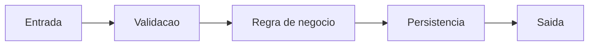

# Fluxo <NOME_FLUXO>

Owner: <time ou pessoa>
Status: Draft
Last Updated: YYYY-MM-DD
Scope: <fluxo>

## Objetivo
Descreva o resultado de negocio esperado.

## Diagrama

## Passo a passo
1. Entrada
2. Validacoes
3. Regras
4. Persistencia
5. Saida

## Tabela de decisao
| Condicao | Comportamento | Mensagem/erro |
|---|---|---|
| <if> | <acao> | <erro> |

## Erros esperados
| Erro | Causa | Acao |
|---|---|---|
| <erro> | <causa> | <acao> |

## Evidencia de teste
Referencie cenarios de teste que cobrem o fluxo.
