# 🔄 FLUXOS DO SISTEMA COMPLETO
## Diagramas e Fluxos de Dados

---

## 📋 CONTEÚDO

1. **Fluxo Principal do Sistema**
2. **Fluxo de Autenticação**
3. **Fluxo de Dashboard**
4. **Fluxo de Registro de Produção**
5. **Fluxo de CRUD de Culturas**
6. **Fluxo de CRUD de Embaladores**
7. **Fluxo de Relatórios**
8. **Fluxo de Configurações**
9. **Fluxo de Exportação Excel**
10. **Fluxo Técnico de Cache**

---

## 🎯 FLUXO PRINCIPAL DO SISTEMA

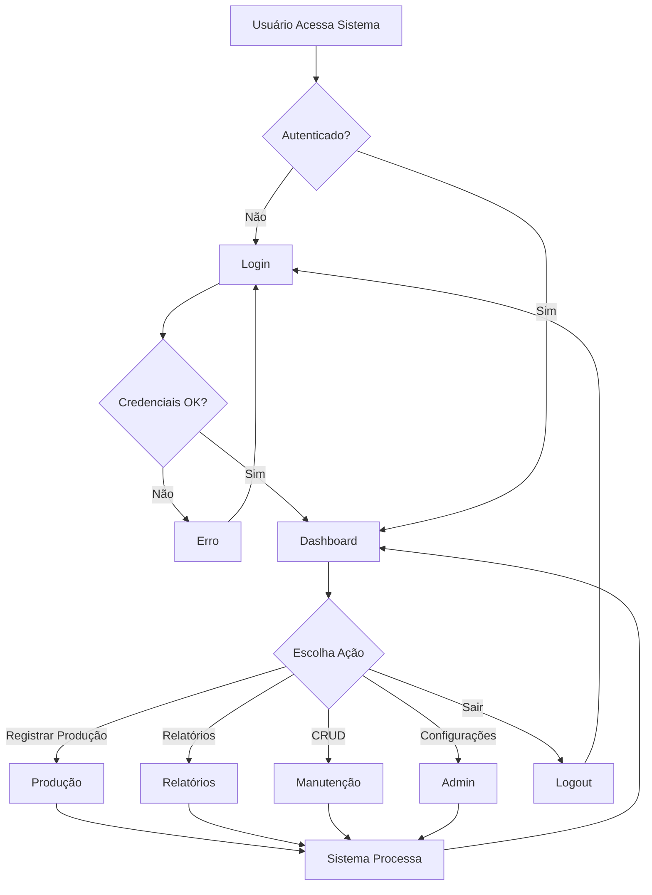

---

## 🔐 FLUXO DE AUTENTICAÇÃO

### **Fluxo Visual**

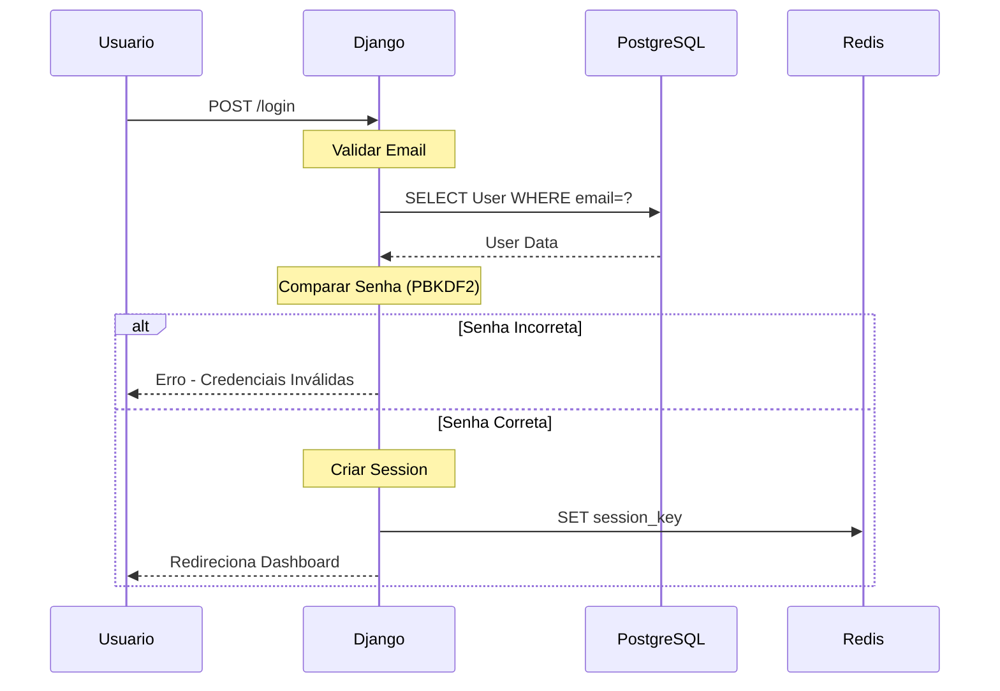

### **Fluxo Textual**

```
1. Usuário Acessa /login
   └─ Recebe formulário HTML

2. Usuário Submete Email + Senha
   └─ POST para /login

3. Django Valida Entrada
   ├─ Email existe?
   └─ Formato correto?

4. Busca Usuário no Banco
   └─ SELECT * FROM core_user WHERE email = ?

5. Compara Senha (PBKDF2)
   ├─ Hash enviado vs. Hash BD
   └─ Match?

6. Se OK:
   ├─ Cria Session (Django)
   ├─ Salva no Redis (cache)
   ├─ Define Cookie Session
   └─ Redireciona /dashboard

7. Se Erro:
   ├─ Incrementa tentativas
   ├─ Exibe mensagem
   └─ Volta para /login

8. Logout:
   ├─ Deleta Session
   ├─ Remove do Redis
   └─ Redireciona /login
```

---

## 📊 FLUXO DE DASHBOARD

### **Fluxo Visual**

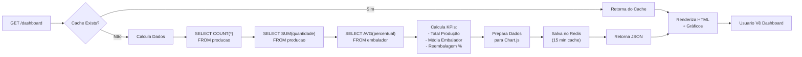

### **Dados Retornados**

```json
{
  "periodo": "07/2026",
  "kpis": {
    "total_producao": 15420,
    "total_reembalagem": 340,
    "media_por_embalador": 128,
    "percentual_reembalagem": 2.2
  },
  "ranking_embaladores": [
    {"nome": "João Silva", "quantidade": 450, "reembalagem": 5},
    {"nome": "Maria Santos", "quantidade": 380, "reembalagem": 2}
  ],
  "evolucao_diaria": [
    {"data": "2026-07-01", "quantidade": 450},
    {"data": "2026-07-02", "quantidade": 520}
  ],
  "graficos": {
    "evolucao_producao": [...],
    "distribuicao_cultura": [...],
    "ranking": [...]
  }
}
```

---

## ✍️ FLUXO DE REGISTRO DE PRODUÇÃO

### **Fluxo Visual Completo**

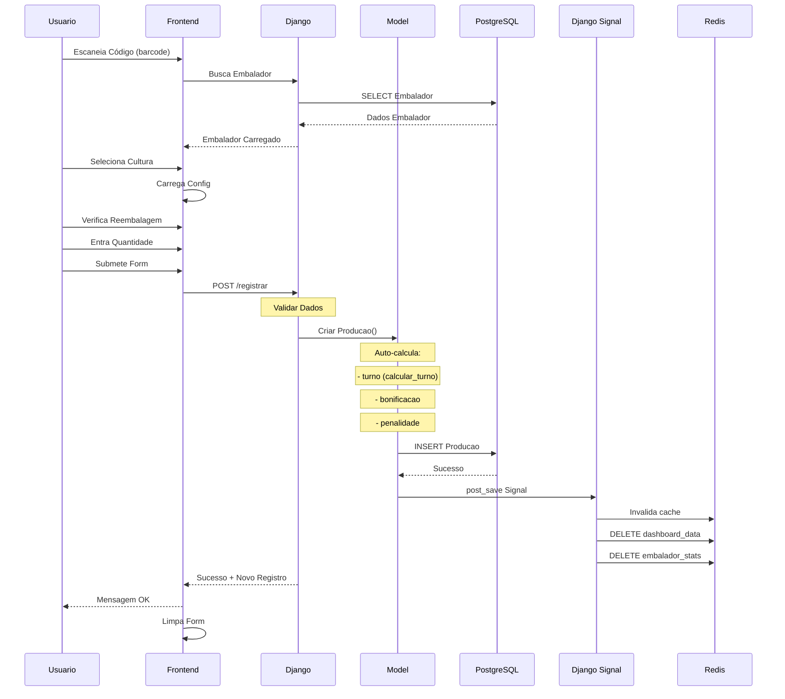

### **Fluxo de Cálculo do Turno**

```python
Entrada: hora = 14:30 (14h30)

calcular_turno(hora):
    h = 14
    if 5 <= h < 12:
        return 'Manhã'      # 5h-12h
    elif 12 <= h < 18:
        return 'Tarde'      # 12h-18h (AQUI!)
    else:
        return 'Noite'      # 18h-5h

Resultado: Turno = 'Tarde'
```

### **Fluxo de Cálculo de Bonificação**

```
1. Busca Configuracao do Sistema
   └─ valor_bonificacao = R$ 1.50

2. Calcula Bonificação
   ├─ quantidade = 100 unidades
   ├─ valor_bonificacao = R$ 1.50
   └─ bonificacao_total = 100 × 1.50 = R$ 150.00

3. Verifica Reembalagem
   ├─ reembalagem = True?
   ├─ Se Sim: penalidade = R$ 1.00
   └─ Se Não: penalidade = R$ 0.00

4. Calcula Final Líquido
   └─ final_liquido = 150.00 - 1.00 = R$ 149.00

5. Salva Registro
   └─ INSERT Producao com todos os valores

6. Snapshot de Configuração
   ├─ Salva valor_bonificacao_snapshot
   ├─ Salva valor_penalidade_snapshot
   └─ Auditoria: ConfiguracaoLog registra alteração
```

---

## 🌾 FLUXO DE CRUD - CULTURAS

### **Visualizar Lista**

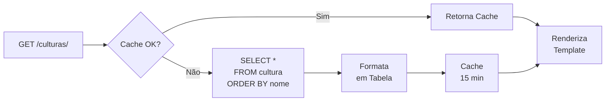

### **Criar Cultura**

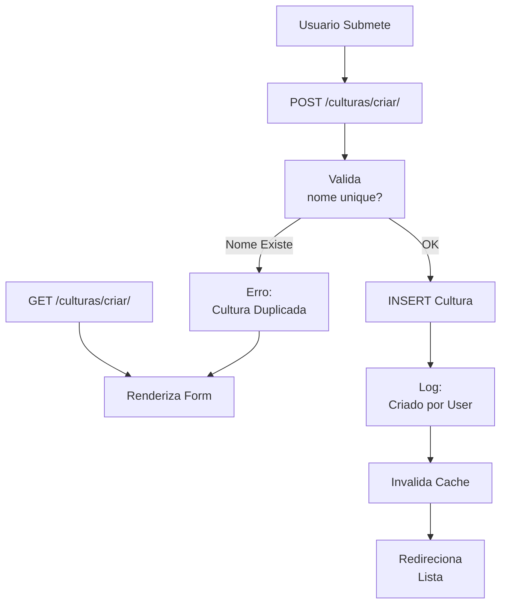

### **Editar Cultura**

```
1. GET /culturas/editar/1/
   └─ Carrega Cultura ID 1

2. Renderiza Form com Dados
   ├─ Nome: "Tomate"
   └─ Criado em: 01/07/2026

3. Usuario Altera: "Tomate" → "Tomate Premium"

4. POST /culturas/editar/1/
   ├─ Valida unique (ignora ID 1)
   ├─ UPDATE cultura SET nome = ?
   └─ Log: modificado_por = User

5. Invalida Cache
   └─ DELETE cache_culturas

6. Redireciona Lista com Mensagem OK
```

### **Deletar Cultura**

```
1. GET /culturas/deletar/1/
   └─ Renderiza Confirmação

2. Verifica Integridade
   ├─ Busca Producao com cultura_id = 1
   ├─ Se Existir:
   │  ├─ Bloqueia Delete
   │  └─ Mensagem: "Não pode deletar, tem registros"
   └─ Se Não Existir:
      └─ Permite Delete

3. POST /culturas/deletar/1/
   ├─ DELETE cultura WHERE id = 1
   ├─ Log: deletado_por = User
   └─ Invalida Cache

4. Redireciona Lista
```

---

## 👤 FLUXO DE CRUD - EMBALADORES

Similar a Culturas, mas com validações adicionais:

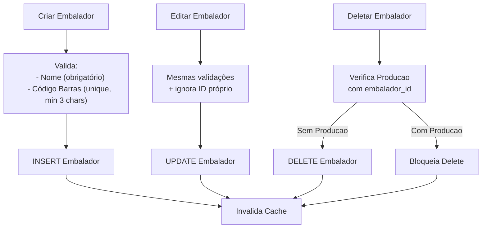

---

## 📈 FLUXO DE RELATÓRIOS

### **Relatório de Bonificação**

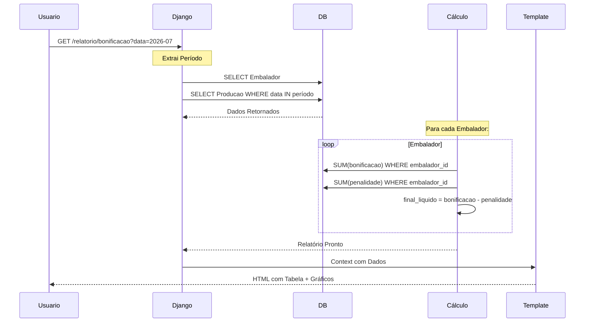

### **Estrutura do Relatório**

```
Relatório de Bonificação - Julho 2026

Embalador          | Producao | Bonificação | Penalidade | Final Líquido
João Silva         |   450    | R$ 675.00   | R$ 5.00    | R$ 670.00
Maria Santos       |   380    | R$ 570.00   | R$ 2.00    | R$ 568.00
Pedro Oliveira     |   520    | R$ 780.00   | R$ 8.00    | R$ 772.00
─────────────────────────────────────────────────────────────
TOTAL              | 1.350    | R$ 2.025.00 | R$ 15.00   | R$ 2.010.00

Gráficos:
- Ranking de Bonificação (Bar Chart)
- Evolução Diária (Line Chart)
- Reembalagem por Embalador (Pie Chart)
```

---

## ⚙️ FLUXO DE CONFIGURAÇÕES

### **Visualizar Configuração**

```
1. GET /configuracoes/
   └─ Apenas Admin

2. SELECT * FROM configuracao
   └─ Singleton (sempre ID 1)

3. Renderiza Form com Valores Atuais
   ├─ valor_bonificacao: R$ 1.50
   ├─ valor_penalidade: R$ 1.00
   └─ Última alteração: por User X em 01/07/2026

4. Usuario Vê:
   - Campo para editar bonificação
   - Campo para editar penalidade
   - Histórico de alterações (últimas 10)
```

### **Alterar Configuração**

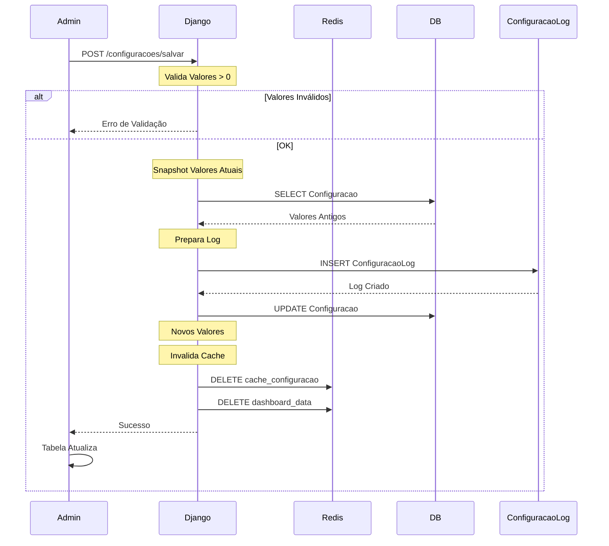

### **Auditoria de Configurações**

```
ConfiguracaoLog:
├─ ID: 1
├─ valor_bonificacao_anterior: R$ 1.00
├─ valor_bonificacao_novo: R$ 1.50
├─ valor_penalidade_anterior: R$ 0.50
├─ valor_penalidade_novo: R$ 1.00
├─ alterado_por: admin_user
├─ data_alteracao: 01/07/2026 14:30:45
└─ motivo: "Ajuste conforme reunião com gerente"
```

---

## 📊 FLUXO DE EXPORTAÇÃO EXCEL

### **Fluxo de Exportação**

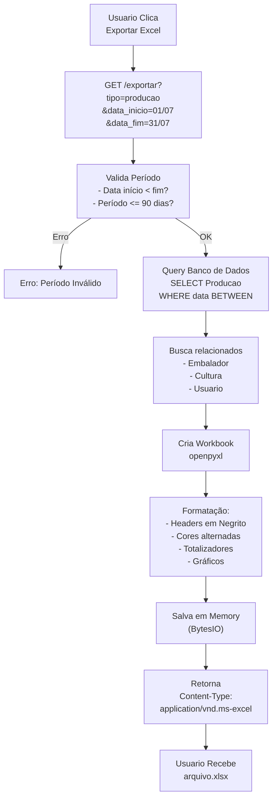

### **Estrutura do Excel**

```
SHEET 1: Produção
┌─────────────────────────────────────────────────────────────┐
│ RELATÓRIO DE PRODUÇÃO - Julho 2026                           │
├─────────────────────────────────────────────────────────────┤
│ Data    │ Embalador    │ Cultura  │ Quantidade │ Reembalagem │
│ 01/07   │ João Silva   │ Tomate   │ 450        │ Não         │
│ 02/07   │ Maria Santos │ Cebola   │ 380        │ Sim         │
├─────────────────────────────────────────────────────────────┤
│ TOTAL                                    1.350    │ 15        │
└─────────────────────────────────────────────────────────────┘

SHEET 2: Bonificação
┌─────────────────────────────────────────────────────────────┐
│ Embalador      │ Producao │ Bonificação │ Penalidade │ Total │
│ João Silva     │ 450      │ R$ 675.00   │ R$ 5.00    │ R$... │
├─────────────────────────────────────────────────────────────┤
│ TOTAL          │ 1.350    │ R$ 2.025.00 │ R$ 15.00   │ R$... │
└─────────────────────────────────────────────────────────────┘

SHEET 3: Gráficos
- Gráfico de Evolução (Line)
- Gráfico de Ranking (Bar)
```

---

## 🔄 FLUXO TÉCNICO DE CACHE

### **Estrutura de Cache**

```
Redis Database:
├─ dashboard_data (TTL: 15 min)
│  └─ {kpis, ranking, evolucao}
│
├─ configuracao (TTL: 1 hora)
│  └─ {valor_bonificacao, valor_penalidade}
│
├─ embalador_stats_<id> (TTL: 15 min)
│  └─ {producao_total, reembalagem%, percentual}
│
└─ session_<id> (TTL: 7 dias)
   └─ {user_id, permissions}
```

### **Invalidação de Cache**

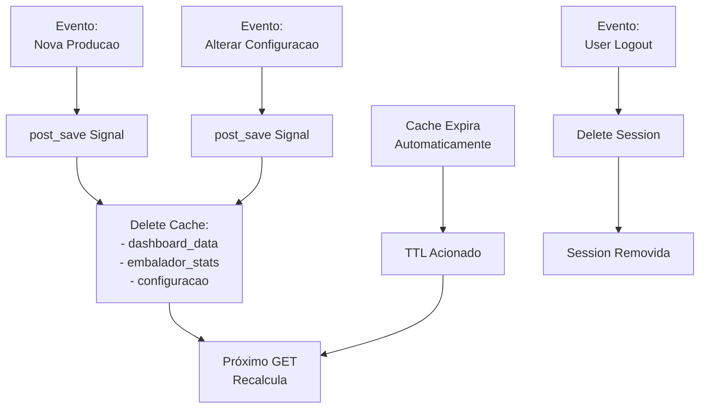

### **Fluxo de Leitura com Cache**

```python
# Pseudocódigo

def obter_dashboard_data():
    # 1. Tenta Cache
    data = cache.get('dashboard_data')
    if data:
        return data  # HIT!
    
    # 2. Cache Vazio - Calcula
    data = {
        'kpis': calcular_kpis(),
        'ranking': calcular_ranking(),
        'evolucao': calcular_evolucao(),
    }
    
    # 3. Salva no Cache (15 min)
    cache.set('dashboard_data', data, 15*60)
    
    return data
```

---

## 🔀 FLUXO DE INTEGRAÇÕES ENTRE MÓDULOS

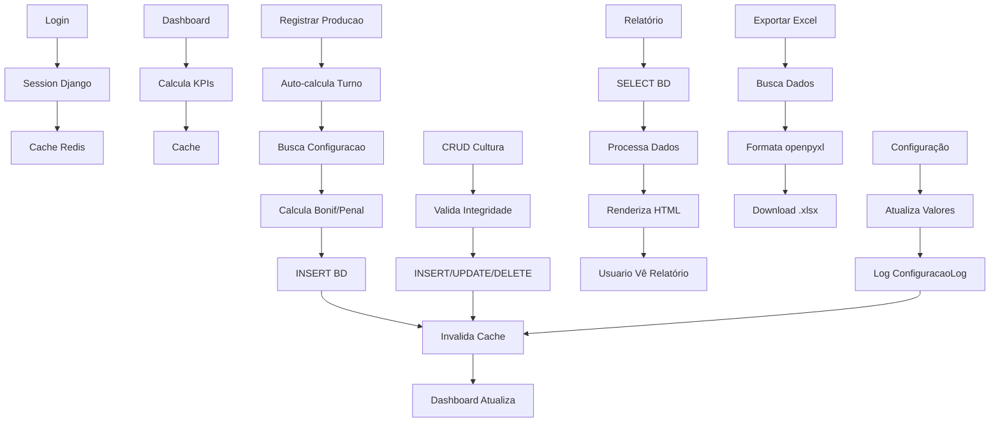

---

## 📱 FLUXO DO USUÁRIO - CASO DE USO COMPLETO

### **Dia Normal de Trabalho**

```
08:00 - INÍCIO DO TURNO
├─ Usuario Acessa http://packing.local
├─ Sistema Detecta Não Autenticado
└─ Redireciona para /login

08:05 - LOGIN
├─ Usuario Insere Email + Senha
├─ Sistema Valida no BD
├─ Cria Session + Redis
└─ Redireciona Dashboard

08:10 - DASHBOARD
├─ Sistema Calcula KPIs (ou retorna cache)
├─ Usuario Vê Gráficos de Produção
└─ Usuario Clica "Registrar Produção"

08:15 - REGISTRO DE PRODUÇÃO (x50)
├─ Usuario Escaneia Código Barrera
├─ Sistema Carrega Embalador
├─ Usuario Seleciona Cultura
├─ Usuario Entra Quantidade
├─ Sistema Auto-calcula:
│  ├─ Turno: Manhã (8:15)
│  ├─ Bonificação: 50 × R$ 1.50 = R$ 75.00
│  └─ Penalidade: R$ 0.00 (sem reembalagem)
├─ Sistema Invalida Cache
└─ Repete 50x até 12:00

12:00 - ALMOÇO + VERIFICAÇÃO
├─ Usuario Acessa Dashboard
├─ Sistema Mostra 50 registros do dia
├─ Gráficos Atualizados
└─ Usuario Vê Seu Ranking

14:00 - TARDE
├─ Continua Registrando Produção
├─ Sistema Muda Turno para "Tarde" (14:00)
└─ Registra com Bonificação Tarde

17:30 - FINAL DO TURNO
├─ Usuario Clica "Meus Relatórios"
├─ Sistema Mostra Bonificação do Dia
├─ Total: R$ 112.50 (75 registros)
└─ Usuario Clica Logout

17:35 - ADMIN VERIFICA
├─ Admin Acessa Dashboard
├─ Admin Clica "Exportar Excel"
├─ Sistema Gera arquivo.xlsx
├─ Admin Faz Download
└─ Admin Abre em Excel (com gráficos)

17:45 - ADMIN ALTERA CONFIG
├─ Admin Clica "Configurações"
├─ Altera valor_bonificacao: 1.50 → 1.75
├─ Sistema Valida
├─ Sistema Registra Log
├─ Cache Invalidado
└─ Mensagem: "Configuração Alterada com Sucesso"

PRÓXIMO DIA - NOVOS VALORES
├─ Sistema Usa novo valor_bonificacao: 1.75
└─ Cálculos com novo valor automaticamente
```

---

## 🎯 RESUMO DOS FLUXOS

| Fluxo | Início | Fim | Cache | BD Ops |
|-------|--------|-----|-------|--------|
| Login | GET /login | Session | Redis | 1 SELECT |
| Dashboard | GET / | HTML | Redis 15min | 3 SELECT |
| Registrar | Form | Cadastrado | Invalida | 1 INSERT |
| CRUD Lista | GET /list | HTML | Redis 15min | 1 SELECT |
| CRUD Criar | GET /new | Criado | Invalida | 1 INSERT |
| CRUD Editar | GET /edit | Atualizado | Invalida | 1 UPDATE |
| CRUD Deletar | GET /del | Deletado | Invalida | 1 DELETE |
| Relatório | GET /report | PDF/HTML | Nenhum | N SELECT |
| Exportar | GET /export | .xlsx | Nenhum | N SELECT |
| Config | GET /settings | Atualizado | Invalida | 1 UPDATE |

---

## 🔐 SEGURANÇA NOS FLUXOS

Cada fluxo implementa:

```
✅ CSRF Protection
   └─ Token em cada POST form

✅ Authentication Check
   └─ LoginRequiredMixin em toda view

✅ Authorization Check
   └─ AdminRequiredMixin onde necessário

✅ Input Validation
   └─ Form.clean() + Model validators

✅ SQL Injection Prevention
   └─ ORM Django (sem raw SQL)

✅ XSS Prevention
   └─ Template escaping automático

✅ Password Security
   └─ PBKDF2 hashing

✅ Session Security
   └─ HttpOnly + Secure cookies
```

---

## 📚 CONSULTE TAMBÉM

- **3_PROMPT_COMPLETO.md** - Detalhes de cada fase
- **4_CODIGO_PRONTO.md** - Implementação dos fluxos
- **5_QUICK_REFERENCE.md** - Comandos rápidos
- **DOCUMENTACAO_DJANGO.md** - Especificação completa

---

**Status:** ✅ Pronto para Usar  
**Versão:** 1.0  
**Última atualização:** 01/07/2026
